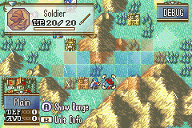

add button hint banner for map, roaming, info menu and title screen. Player can choose to disable it mid-game through config display_hint setting.



just need to put the file in the root dir (next to `app` folder or `run_editor.py` file) and enter in the console:
```sh
git apply button-hint.patch
```
